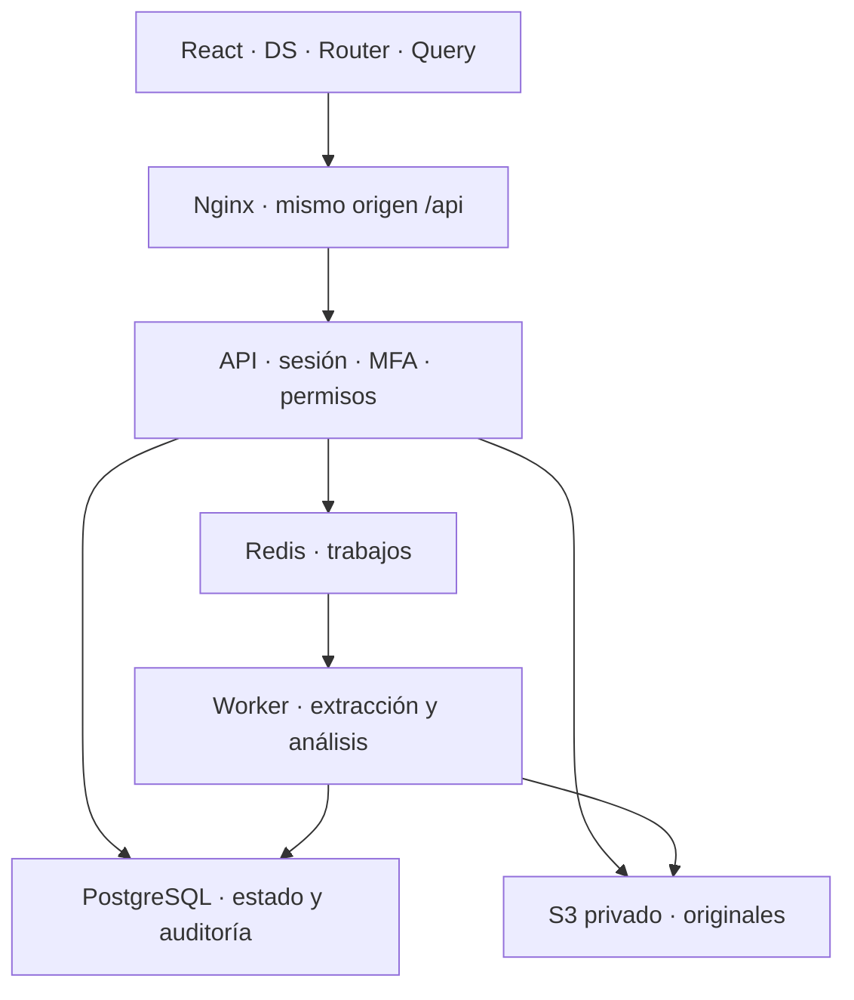

# Arquitectura implementada y límites de seguridad

## Interfaz y contratos

React + TypeScript, React Router y TanStack Query. Las pantallas consumen `apps/web/src/design-system`: controles, campos, feedback, carga, tablas, selectores, layout y SidePanel. Las listas usan el DSL de TanStack Table; las evidencias financieras usan primitivas semánticas de tabla para conservar contexto y decimales exactos. ESLint impide controles nativos fuera del DS, imports del adaptador legado y llamadas fetch que evadan el transporte.

Las fábricas de queries separan identidad y organización. Los hooks de mutación deshabilitan reintentos automáticos de escrituras, conservan errores de conflicto e invalidan recursos afectados. El contexto de membresía no se vuelve a consultar como efecto indiscriminado de cada escritura: el backend verifica permisos actuales en cada operación. Una actualización en segundo plano no debe desmontar un formulario con cambios.

El transporte HTTP permite únicamente rutas relativas `/api/`, envía cookies, impide seguir redirecciones, usa `no-store` y propaga cancelación. Un 401 dispara el cierre de la frontera privada. Los cambios de identidad cancelan consultas y vacían caché antes de permitir contenido privado nuevo. La UI no guarda tokens de sesión en localStorage.

## Acceso y autorización

React Router protege rutas privadas antes de montar pantallas de organizaciones. Es una protección de navegación; la autorización efectiva siempre pertenece al servidor. Better Auth utiliza sesiones persistidas y cookies HttpOnly/Secure en producción, con SameSite. Duración explícita: ocho horas renovables, actualización cada treinta minutos y frescura de quince minutos; esta última solo se aplica donde el endpoint exige sesión reciente.

La API comparte un guard de sesión actual, correo verificado, membresía, rol, UUID y origen exacto para escrituras. Los casos de uso mantienen sus propias comprobaciones de organización y permisos. Ni el ID de organización del cliente ni una ruta privada conceden autorización. Las respuestas privadas/auth usan `no-store`; los originales se entregan como attachments autorizados.

## Segundo factor

`AUTH_REQUIRE_MFA=true` en producción; desarrollo local puede usar false. El servidor exige alta y verificación antes de acceder a datos organizativos. También exige prueba cuando la cuenta activó MFA aunque la política global sea opcional. La prueba es `Session.mfaVerifiedAt`, no solamente el flag del usuario: otras sesiones anteriores al alta permanecen bloqueadas.

El flujo incluye contraseña actual, QR generado localmente, clave manual, códigos de recuperación de un uso y confirmación de guardado. Semilla y códigos se mantienen únicamente en estado transitorio del componente; no se envían a generadores QR externos ni se guardan en caché de consultas, almacenamiento del navegador o logs. Los intentos fallidos tienen bloqueo por cuenta; no se habilita confiar en dispositivo. Las rutas de gestión de factores tampoco permiten saltarse la verificación con una sesión antigua.

La migración añade factores cifrados y prueba de sesión. `AUTH_SECRET` debe conservarse estable: protege también los secretos y recuperaciones MFA. Rotarlo exige un procedimiento de recuperación planificado. No desactivar MFA en producción para solventar errores de configuración.

## Servicios

Nginx entrega CSP restrictiva, protección contra framing y permisos de navegador desactivados. Conserva la CSP más restrictiva de los originales. No se confía indiscriminadamente en cabeceras reenviadas. Las llamadas externas y futuros conectores pertenecen a adaptadores del servidor; no exponen credenciales al navegador.

## Condiciones que requieren comprobar el servidor

La revisión de código y los contenedores de CI no verifican el servidor de Coolify. Antes del piloto con datos reales hay que comprobar certificado/dominio HTTPS, topología del proxy y límites por IP, firewall, acceso al host, cifrado de volúmenes, backup externo cifrado y una restauración real, retención y recuperación de credenciales. Los hilos de extracción tienen límites de recursos, pero no equivalen a un sandbox del sistema operativo: el aislamiento del parser frente a archivos hostiles sigue siendo un riesgo documentado.

La evidencia exacta de esta fase se registra en `.agents/tasks/2026-10-17-architecture-closure.json`. No se declara cumplimiento completo de OWASP ni una auditoría de producción por estos cambios.
